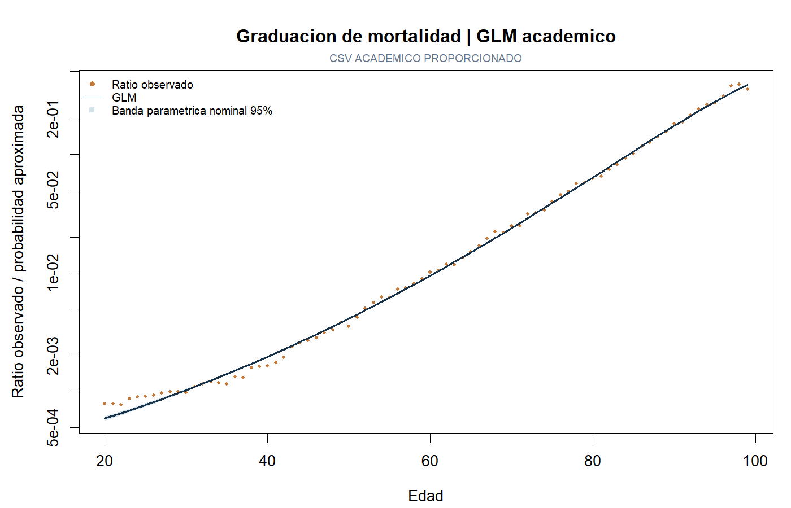
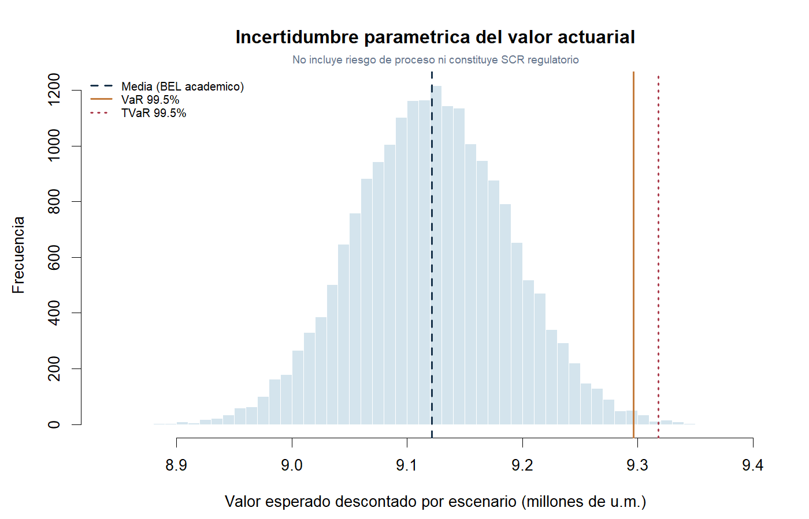

# Graduación de mortalidad y valoración actuarial en R

Comparación de **LM sobre logit y GLM binomial**, simulación de incertidumbre
paramétrica y valoración de prestaciones de fallecimiento en una cartera teórica.
Proyecto académico en equipo incluido en el portafolio de **Ulises Matadama Lara**.

> Código ejecutable y resultados recalculados. Las medidas de riesgo son
> académicas: no constituyen SCR regulatorio ni garantía de solvencia.

## Qué demuestra el proyecto

- Validación de datos por edad y comparación de tres especificaciones por AIC.
- Graduación de mortalidad con GLM y diagnóstico de dispersión.
- Simulación paramétrica reproducible, valoración descontada y medidas de cola.
- Comunicación de supuestos, limitaciones y diferencias entre ejercicios y aplicaciones regulatorias.



## Probar sin descargar datos

Requiere **R 4.5.1 o compatible**. El motor usa sólo paquetes que acompañan a R;
no necesita `tidyverse`, Quarto, credenciales ni instalar dependencias.

Desde la raíz del repositorio:

```sh
Rscript --vanilla scripts/ejecutar.R
Rscript --vanilla tests/verificar.R
```

La primera orden genera una **demo sintética** etiquetada en `resultados/demo/`.
No reproduce la mortalidad de Chile ni se presenta como resultado de la entrega.

## Ejecutar con el CSV académico

El archivo `datos_equipo1.csv` ya fue recuperado y se utilizó para recalcular los
resultados de `resultados/real/`. No se redistribuye en este paquete público;
su copia local y su huella se conservan fuera del repositorio.

```sh
Rscript --vanilla scripts/ejecutar.R --datos data/local/datos_equipo1.csv --salida resultados/real
```

Puede indicarse otra ruta local con comillas. Ver [datos y fuentes](docs/DATOS_Y_FUENTES.md).

## Método y alcance

Se seleccionan edades 20–99 y se comparan términos lineal, cuadrático y combinado.
Se conserva la aproximación binomial del ejercicio original, que redondea `Total`.
**Si ese denominador es exposición en personas-año, muertes/Total no es directamente
una probabilidad anual.** Por eso se denomina ratio observado y se explicita esta
limitación: el redondeo no resuelve la diferencia de unidades.

Los coeficientes GLM se simulan bajo una normal asintótica, con semilla fija y
20,000 escenarios. El ejercicio de valoración supone 1,000 asegurados de edad 25,
plazo de 30 años, prestación de 300,000 unidades monetarias al final del año de
fallecimiento y descuento anual supuesto de 4.4%. La entrega expresaba la prestación
en UDIS; aquí no se convierte a pesos ni se adopta una tasa libre de riesgo observada.

Se reportan media del valor de prestaciones (`BEL_academico`), VaR y TVaR de esa
distribución, junto con sus excesos sobre la media. La incertidumbre representada
es **paramétrica**, sin simular muertes individuales ni todos los riesgos de una aseguradora.

Consultar [revisión técnica](docs/REVISION_TECNICA.md) antes de interpretar las bandas,
los cuantiles o las diferencias respecto de la entrega histórica.

**Conciliación con el informe original:** el ajuste GLM reproduce sus coeficientes
y AIC, pero la valoración histórica de prestaciones no se reproduce con la edad
inicial y el horizonte documentados. Se publican los valores recalculados y la
comparación en [resultados explicados](docs/RESULTADOS.md), sin sustituir silenciosamente
las cifras de la entrega original.

## Resultados y archivos

| Ruta | Contenido |
|---|---|
| `R/mortalidad.R` | Preparación, modelos, simulación y valoración |
| `scripts/ejecutar.R` | Pipeline por línea de comandos |
| `tests/verificar.R` | Identidad actuarial, escala, cola y reproducibilidad |
| `resultados/real/` | CSV y gráficos del archivo académico recuperado |
| `resultados/demo/` | Ejemplo independiente con datos inventados |
| `docs/` | Revisión, procedencia, créditos y resultados explicados |



Las cifras se generan por código, no se copian del texto del informe histórico.
El archivo `sessionInfo.txt` registra el entorno y `diagnostico.csv` la semilla,
el número de simulaciones y la dispersión. Las bandas son nominales, no intervalos
predictivos validados. GitHub Actions vuelve a ejecutar las pruebas y la demo sintética.

## Autoría y referencias

Trabajo original de Carlos Cárdenas Osorio, Diego Uriel Hernández Sotelo,
Ulises Matadama Lara y Samuel Arias García. [Créditos completos](docs/CREDITOS.md).

- Fuente declarada: [Human Mortality Database](https://www.mortality.org/), Chile, año 2000.
- [GLM en R](https://stat.ethz.ch/R-manual/R-devel/library/stats/html/glm.html).
- [Condiciones de HMD](https://www.mortality.org/Data/UserAgreement).

La documentación distingue la fuente declarada, los cálculos verificados y las
limitaciones que requieren trabajo adicional. No se afirma un ajuste explícito
de Gompertz ni una estimación bayesiana que el código no implementa.
